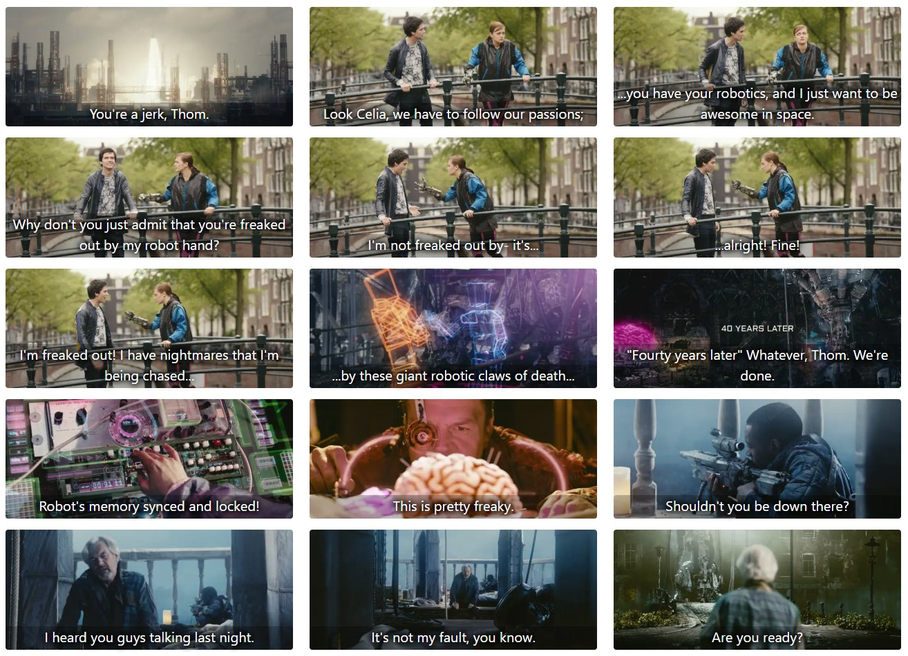

# story-bard

Turns a video and its captions into a storyboard web page: one frame per caption, with the caption text overlaid.



*Sample output made from the English subtitles of Tears of Steel. The generated page is in [docs/sample](docs/sample). Tears of Steel (c) Blender Foundation | [mango.blender.org](https://mango.blender.org), licensed [CC BY 3.0](https://creativecommons.org/licenses/by/3.0/).*

## Install

```
python3 -m pip install -r requirements.txt
```

## Usage

```
python3 make_storyboard.py --input-video video.webm --input-subs video.en.vtt --output-folder out/
```

| Option | Meaning |
|---|---|
| `--input-video` | video file. Default: the first `.webm`/`.mp4` in the current directory |
| `--input-subs` | caption file, `.vtt` or `.srt`. Default: the first one in the current directory |
| `--output-folder` | where everything is written (created if missing). Default: the current directory |
| `--jpg` | write JPG images instead of WebP |
| `--quality` | image quality, 1-100, for WebP or JPG. Default: 60 for WebP, 75 for JPG |
| `--title` | page title. Default: the video's file name |
| `--force` | overwrite output from a previous run. Without it the script stops if the output folder already has `frames.js`, `index.html` or `NNNNNN.webp`/`NNNNNN.jpg` files |
| `-v`, `--verbose` | print a line per frame instead of showing a progress bar |

`.srt` captions are converted to `.vtt` first, and the converted file is saved in the output folder.

## Output

Everything is written to the output folder:

- `000001.webp`, `000002.webp`, ... : one image per caption (resized to 720px wide if the video is wider). With `--jpg` these are optimized progressive `.jpg` files instead. Only one format is written, never both
- `frames.js`: the page title and frame data (`{image, width, height, timestamp, caption}` per frame), loaded by the page as a plain script
- `index.html`: a copy of `viewer.html`

Open `index.html` directly from disk or upload the whole folder to a web server. No server is needed.

## How the viewer works

`viewer.html` is a static template. It builds the grid from `frames.js` and loads the images itself instead of using the browser's native lazy loading:

- an image is only requested once its figure is within 1000px of the viewport
- requested images load lowest-number first, at most 4 at a time, so the page fills in top to bottom
- each `` has explicit width, height and aspect-ratio, so the page height is right before any image arrives

Settings are at the top of the script in `viewer.html`: `LOOKAHEAD`, `MAX_CONCURRENT`, and `DEBUG` (set to `true` to log the loading queue to the browser console).

## License

GNU General Public License v3.0. See [LICENSE](LICENSE).

## Files

- `make_storyboard.py`: extracts the frames and writes `frames.js`
- `viewer.html`: the page template
- `requirements.txt`: Python dependencies
